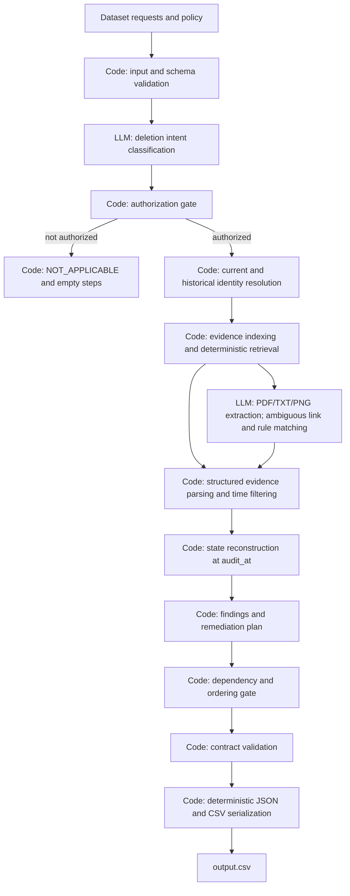

# Architecture

> Planning input status: `plan_v3.md` was not found in the repository or `docs/`. This architecture follows the explicit ownership boundaries in the request and the available challenge contract. The ordering conflict documented in `docs/data_findings.md` remains unresolved.

## WHAT CODE OWNS

- **Identity:** resolve request emails against the current identity snapshot and historical identifier changes, preserving the stable user reference and all grounded links.
- **Retrieval:** enumerate the evidence manifest, locate files, parse structured SQL/JSON/log evidence, and retrieve candidates through exact identifiers, resource IDs, hashes, system IDs, and timestamps. Evidence paths are interpreted relative to `DATASET_DIR`.
- **State:** filter evidence to `audit_at`, combine grounded observations, and distinguish record state from workflow/activity claims.
- **Ordering:** apply the contract’s phase and operation ordering, then system/resource ordering where applicable. Dependency constraints are explicit and must be validated; the conflict below is not silently resolved.
- **Serialization:** emit the exact `case_id,deletion_status,steps_json` CSV schema and stable JSON arrays, with consecutive step numbers and exact allowed step fields.
- **Validation:** check status/phase/operation/state combinations, evidence references, timestamps, step numbering, and required evidence-ID behavior before writing output.
- **Gate:** prevent an unsupported `COMPLETE` result; require authorized intent, evidence grounded at or before `audit_at`, and policy-compliant treatment for every identified resource before an output can pass.

## WHAT THE LLM OWNS

The LLM is limited to:

- classifying whether the request text authorizes deletion, including language and negation;
- extracting facts from PDF, TXT, and PNG artifacts;
- resolving ambiguous links between evidence and a subject/resource; and
- matching ambiguous evidence descriptions to a deletion rule.

The LLM does not decide identity resolution, retrieve files, determine final state, order steps, serialize output, or bypass validation/gates. Its extractions and matches are candidate facts; code retains provenance and applies time, policy, and output constraints.

## Evidence kind, authority, and scope

`evidence_files.csv` provides `file_id`, path, origin, and capture time; it does not supply an `evidence_kind` column or establish case membership. `evidence_kind` is derived from the file type/content during indexing. Authority is limited to the source’s domain and capture scope.

| Evidence kind | Authority | Scope and limits |
| --- | --- | --- |
| Policy CSV (`deletion_rules.csv`) | The supplied policy for category/condition treatment | Defines required handling; does not prove whether a particular record exists or is linked to a person. |
| Current identity CSV | Current identity snapshot for the listed subject | Current values at `updated_at`; cannot alone prove historical aliases or state at an earlier `audit_at`. |
| Identity audit CSV | Historical field changes in the rows supplied | Establishes recorded old/new values and event times; does not establish that every external system was updated. |
| SQL snapshot | Direct row contents in named tables/replicas at the snapshot time | Supports presence, redaction, retention, or replica-drift findings for captured rows. These dumps are sparse/scoped extracts and do not establish global absence. |
| Structured JSON record/snapshot | Fields and records present in the captured export | Supports state only for the named records/collections and timestamp; export completeness is bounded by its declared scope. |
| Operational log | Events and readback outcomes emitted by the named service | Establishes that the log contains those events; activity/result messages remain claims unless corroborated by state evidence. |
| PDF/TXT business artifact | Facts visibly/textually recorded in that document | Supports those named facts at the document’s capture time; does not establish system-wide deletion or absence. |
| PNG console/screenshot | Rows, fields, and status visible in the captured screen | Point-in-time view of the shown page/query; cannot establish unseen rows, full-table coverage, or global absence. |
| `system_activity.csv` | Recorded operation/activity claims | Global and potentially unrelated; does not prove resulting resource state on its own. |
| Sample output | Public examples of expected output decisions/serialization | Demonstrates sample answers only; does not override a conflicting contract clause or establish hidden-case outcomes. |

## Failure paths

- Missing or unreadable manifest target: preserve the file ID/path failure and do not claim that the resource is absent.
- Malformed or unsupported artifact: retain its metadata and report parsing failure; do not treat parse failure as evidence of deletion.
- Evidence after `audit_at`: exclude it from that case’s state reconstruction.
- Unresolved identity or ambiguous subject/resource link: do not silently attach the record to a person; hold the case from a passing completion gate for review.
- Conflicting or incomplete state evidence: preserve both sources and their capture times; do not convert uncertainty into `COMPLETE`.
- LLM timeout, invalid extraction, or unsupported output: retry only within configured limits, then use the same unresolved-evidence path; code still validates every emitted step.
- Unauthorized request: emit `NOT_APPLICABLE` with `steps_json=[]` as required by the contract.

## Module boundaries

- `config.py`: paths, model identifiers/settings, environment-only API credential loading, and prompt version.
- `ghost_audit.input`: CSV loading, schema checks, and case iteration.
- `ghost_audit.identity`: current/historical identifier resolution.
- `ghost_audit.evidence`: manifest indexing, evidence-kind detection, deterministic retrieval, structured parsers, and provenance.
- `ghost_audit.llm_tasks`: narrow intent, document/image extraction, and ambiguous matching interfaces; no state or planning decisions.
- `ghost_audit.state`: audit-time filtering and resource-state reconstruction.
- `ghost_audit.planning`: findings, policy treatment, remediation, and verification coverage.
- `ghost_audit.ordering`: phase/operation/system/resource order and dependency constraints.
- `ghost_audit.validation`: schema, provenance, policy, timestamp, and sequence gates.
- `ghost_audit.output`: deterministic JSON/CSV serialization to the repository-root `output.csv`.
- `ghost_audit.pipeline`: orchestration only; delegates each responsibility to its module and stops a case when a required stage fails.

## Open data/contract conflict

`docs/data_findings.md` records a sample/contract ordering conflict in `case_16`: the sample orders deletion of the `account_service` profile before the same-subject `search_service` document, while the contract says downstream copies precede their source when a dependency requires it. The implementation must not choose between these rules until the conflict is clarified.
# Design Tradeoffs

## Decision 1: Code-built plans

Code builds the plan from labeled items; the LLM never writes steps. The alternative is one LLM call returning the full `steps_json`, with code only validating it. The contract fixes phases, operation order, and citation rules, so deterministic serialization removes a class of order and format errors. The cost is that a wrong rule or state mapping can mislabel a whole class of cases at once. Measure Config A (code-built steps) against Config B (LLM-written steps), using the same retrieval and scoring on the 32 samples. The primary metric is status accuracy, followed by step-level accuracy. Deltas under 10 percentage points are within noise.

## Decision 2: Unknown state blocks completion

`UNKNOWN` state blocks `COMPLETE` and goes to the review loop; it is never read as `ABSENT`. Absence is hard to prove, and a false `COMPLETE` is the costly error in this task. The cost is that some cases that are really complete will be held back until evidence coverage improves.

# Setup

# Environment Variables

# Run Commands

# Evaluation

# Known Limitations

